# CTI-BTP Platform — Workflow Guide

**Cross-Organisational Cyber Threat Intelligence Sharing with PR-RABE Encryption**

> Flask + React | SQLite | PR-RABE (charm-crypto on WSL/Linux)

---

## Architecture Overview

| Layer | Tech | Role |
|-------|------|------|
| Frontend | React + Vite (port 5173) | SPA dashboard |
| Backend | Flask (port 5000, WSL) | REST API + crypto |
| Crypto | charm-crypto (bilinear pairings) | PR-RABE encryption |
| Database | SQLite (`data/cti.db`) | Persistent storage |

---

## Case 1: Existing User Login

### Step 1 — Landing Page

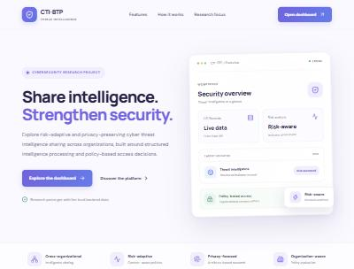

- Public page. Click **"Open dashboard"** (top-right) or **"Explore the dashboard"**.
- Shows platform features: cross-org sharing, risk scoring, conflict visibility.

### Step 2 — Sign In

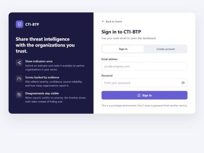

- Enter your **email** and **password**.
- Click **Sign in**.
- Token is stored in `sessionStorage` (1-hour expiry).
- On success → redirects to Dashboard Overview.

**Demo accounts** (from seed script):
| Email | Password | Organization |
|-------|----------|-------------|
| alice@alphabank.com | alice123 | Alpha Bank (Finance) |
| bob@cityhospital.com | bob123 | City Hospital (Healthcare) |
| carol@deltainsurance.com | carol123 | Delta Insurance (Finance) |

---

## Case 2: New User Registration

### Step 1 — Create Account

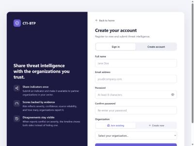

- Click **"Create account"** tab on the login screen.
- Fill: Full name, Email, Password (min 8 chars), Confirm password.
- **Organization** — two options:
  - **Join existing**: Select from dropdown of registered organizations.
  - **Create new**: Enter org name + sector → creates the org and assigns you to it.
- Click **Create account** → auto-login → Dashboard.

---

## Dashboard Pages (Global Workspace)

After login, the sidebar shows 8 pages under **"Global Workspace"**.

### 1. Overview

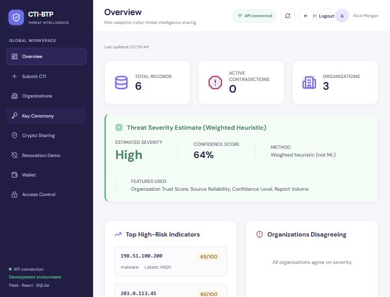

**What you see:**
- **KPI strip**: Total Records, Active Contradictions, Organizations count.
- **Threat Severity Estimate**: Weighted heuristic score (not ML) — shows estimated severity, confidence %, and features used.
- **Top High-Risk Indicators**: Ranked by temporal risk score (severity + volume + cross-sector impact + time decay).
- **Organizations Disagreeing**: Flags when different orgs report conflicting severities for the same indicator.

### 2. Submit CTI

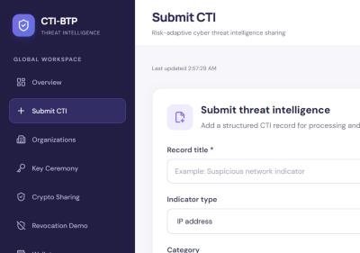

**What you see:**
- Form to submit a new threat intelligence record.
- Fields: Title*, Indicator type (IP/domain/URL/SHA-256/CVE), Indicator value, Category, Severity, Confidence, Sharing sector, Source type, Source reliability, Observation date, Description*.
- Your organization is auto-populated from your login.
- On submit → record is processed, normalized, STIX bundle generated, risk scored, and stored.

### 3. Organizations

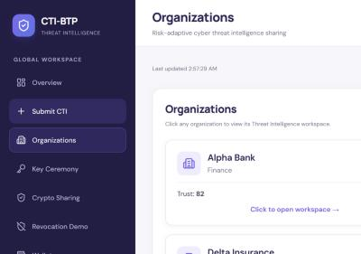

**What you see:**
- Card grid of all registered organizations.
- Each card shows: Name, Sector, Trust Score, Policy Violations count.
- Click **"Add Organization"** to create a new one.
- **Click any org card** → enters that org's **Workspace** (see Org Workspace below).

### 4. Key Ceremony (PR-RABE Setup)

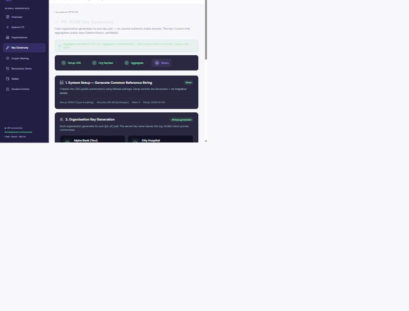

**What you see:**
- 4-step progress bar: Setup CRS → Org KeyGen → Aggregate → Ready.
- **This must be completed before encryption/decryption works.**

**Steps:**
1. **Initialise CRS** — Generates Common Reference String using bilinear pairings (SS512, Type-A). Setup secrets are discarded (no trapdoor).
2. **Org Key Generation** — Each org generates its own (pk, sk) pair. Secret key never leaves the org. Attributes assigned: `SECTOR:{sector}` + `TRUST:{HIGH|MEDIUM|LOW}` based on dynamic trust score.
3. **Aggregate** — Key Curator combines all public keys into a Master Public Key (mpk). Deterministic — curator holds no secrets.
4. **Ready** — System can now encrypt/decrypt using PR-RABE.

> **(You)** label shows next to your org. All orgs must register keys before aggregation.

### 5. Crypto Sharing

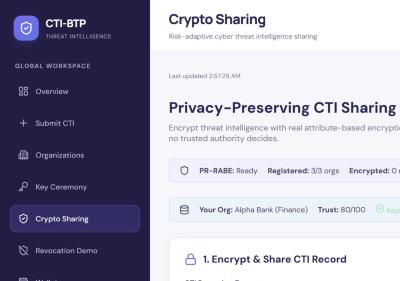

**What you see:**
- Status bar: PR-RABE state (Ready/Not initialized), registered orgs count, your org info.
- **Encrypt**: Select a CTI record → policy auto-generated from severity+sector (e.g., `SECTOR:FINANCE AND TRUST:HIGH`) → encrypted using PR-RABE with policy hiding.
- **Decrypt**: Select an encrypted record → attempts decryption with your org's attributes. Shows success/failure + timing.
- **Revoke**: Revoke an attribute from your org (triggers AGK rotation).

**Key concept**: Only organizations whose attributes satisfy the LSSS policy can decrypt. The policy is hidden — unauthorized orgs cannot even see what attributes are required.

### 6. Revocation Demo

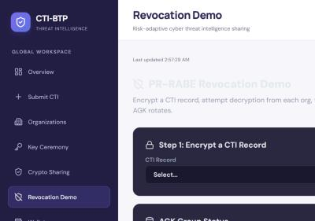

**What you see:**
- Interactive 3-step demo showing PR-RABE revocation in action.
- **Step 1**: Encrypt a record with a chosen policy.
- **Step 2**: Try decrypting from each organization — see who has access and who is blocked.
- **Step 3**: Revoke an attribute (e.g., `TRUST:HIGH` from an org) → AGK rotates → re-encrypt → that org loses access without changing their private key.
- Shows AGK Group Status table with version numbers and member counts.

> This page uses demo-specific endpoints so it can test decryption as any org, not just yours.

### 7. Wallet

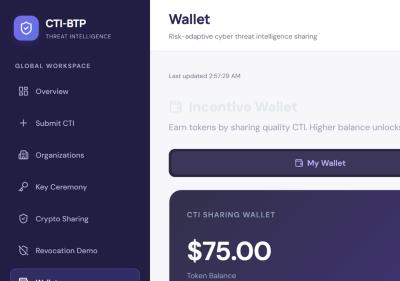

**What you see:**
- **Token Balance**: Your org's incentive wallet.
- **Tier**: Basic (<50) / Standard (50-99) / Premium (100+).
- **Transaction History**: All token events — sharing rewards (+10), high-confidence bonuses (+5), cross-sector bonuses (+3), violation penalties (-20), revocation penalties (-50).
- **Leaderboard tab**: All orgs ranked by token balance.

### 8. Access Control

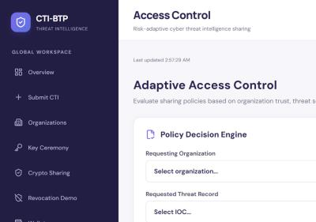

**What you see:**
- **Policy Decision Engine**: Select a requesting org + a threat record → evaluate access.
- Decision shows: GRANTED or DENIED, with context — FIPS 199 sensitivity, required LSSS policy, org trust score, org attributes, missing attributes, risk level.
- **Security Audit Trail**: Log of all access decisions with timestamps.

---

## Organization Workspace

Click any org on the Organizations page → enters that org's workspace with 4 dedicated pages.

### PDF Intelligence

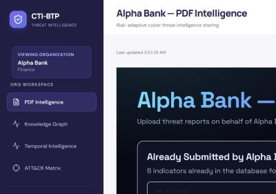

- Upload threat PDF reports (e.g., APT analysis papers).
- AI extracts IOCs (IPs, domains, hashes, CVEs) from the PDF.
- Extracted indicators are automatically added as CTI records for that org.
- Shows already-submitted indicators for that org.

### Knowledge Graph

- Interactive force-directed graph visualization.
- Nodes = Organizations + IOCs. Links = "submitted" relationships.
- See which orgs share common indicators (overlap = potential correlation).

### Temporal Intelligence

- Timeline view of how indicators evolve over time.
- Risk score with time-decay: recent activity scores higher.
- Cross-sector impact tracking.
- Contradiction detection: flags when orgs disagree on severity.

### ATT&CK Matrix

- Maps org-submitted indicators to MITRE ATT&CK techniques.
- Collaborative filtering: suggests techniques an org hasn't seen yet, based on what similar orgs report.
- Global frequency heatmap across all orgs.

---

## PR-RABE Cryptography Flow

```
┌─────────────────────────────────────────────────────┐
│  1. SETUP (Key Ceremony)                            │
│     CRS generated → bilinear pairing params         │
│     Setup secrets discarded (no trapdoor)           │
├─────────────────────────────────────────────────────┤
│  2. KEYGEN (Per Organization)                       │
│     Each org → (pk, sk) pair                        │
│     Attributes: SECTOR:X + TRUST:Y                  │
│     IsValid check proves key correctness            │
├─────────────────────────────────────────────────────┤
│  3. AGGREGATE                                       │
│     Key Curator combines all pk → Master PK (mpk)   │
│     Distributes helper keys (hk) to each org        │
│     Curator holds NO secrets                         │
├─────────────────────────────────────────────────────┤
│  4. ENCRYPT (KEM-DEM Hybrid)                        │
│     Policy: "(SECTOR:FINANCE AND TRUST:HIGH)"       │
│     KEM: PR-RABE encrypts symmetric key under policy│
│     DEM: AES-GCM encrypts the actual CTI data       │
│     Policy hiding: attribute names visible,          │
│                    values hidden from unauthorized   │
├─────────────────────────────────────────────────────┤
│  5. DECRYPT                                         │
│     Org uses sk + hk + mpk                          │
│     If attributes satisfy policy → symmetric key    │
│     → AES-GCM decrypts CTI data                     │
│     If not → DecryptionFailed (no information leak) │
├─────────────────────────────────────────────────────┤
│  6. REVOKE                                          │
│     Revoke attribute from org                       │
│     AGK (Attribute Group Key) rotates               │
│     All records re-encrypted with new AGK           │
│     Org's private key UNCHANGED                     │
│     But they can no longer derive the new AGK       │
│     → Decryption fails for revoked attribute        │
└─────────────────────────────────────────────────────┘
```

### Trust → Attributes Mapping

| Trust Score | Trust Tier | LSSS Attribute |
|------------|-----------|----------------|
| 80-100 | HIGH | TRUST:HIGH |
| 50-79 | MEDIUM | TRUST:MEDIUM |
| 0-49 | LOW | TRUST:LOW |

### Auto-Policy Generation

| Record Severity | Required Trust |
|----------------|---------------|
| Critical / High | TRUST:HIGH |
| Medium | TRUST:MEDIUM |
| Low | TRUST:LOW |

If the record has a specific sharing sector (e.g., Finance), the policy becomes:
`(SECTOR:FINANCE AND TRUST:HIGH)` — both conditions required.

---

## Dynamic Trust Score

Trust is computed from 4 weighted components (not static):

| Component | Weight | How it works |
|-----------|--------|-------------|
| Sharing | 35% | Log-growth based on CTI submissions (maxes ~20 submissions) |
| Violations | 30% | Each violation = -25 points on this component |
| Reliability | 20% | Ratio of high-confidence submissions |
| Base | 15% | Starting score (60 for active orgs) |

Special cases:
- **Inactive org** → trust = 0
- **Revoked org** → trust = 10

---

## Running the Platform

### Backend (WSL terminal)
```bash
cd /mnt/c/Users/asus/Desktop/CTI-BTP
source ~/charm-env/bin/activate
python -m backend.app
```
Runs on `http://127.0.0.1:5000`

### Frontend (Windows terminal)
```bash
cd C:\Users\asus\Desktop\CTI-BTP\frontend
npm run dev
```
Runs on `http://localhost:5173`

### Seed demo data
```bash
cd /mnt/c/Users/asus/Desktop/CTI-BTP
source ~/charm-env/bin/activate
python -m scripts.seed_demo
```
Creates 3 orgs, 5 users, and sample CTI records.

---

## Important Notes

- **Key Ceremony is in-memory**: If the backend restarts, you must re-run the ceremony (Init → Keygen all orgs → Aggregate).
- **charm-crypto requires Linux/WSL**: The real PR-RABE runs only on Linux. On Windows without WSL, a fallback AES engine is used (not cryptographically meaningful for ABE).
- **Session token expires in 1 hour**: After expiry, the UI auto-detects and redirects to login.
- **Trust scores are dynamic**: They recalculate on every trust query based on current sharing history, violations, and reliability.
